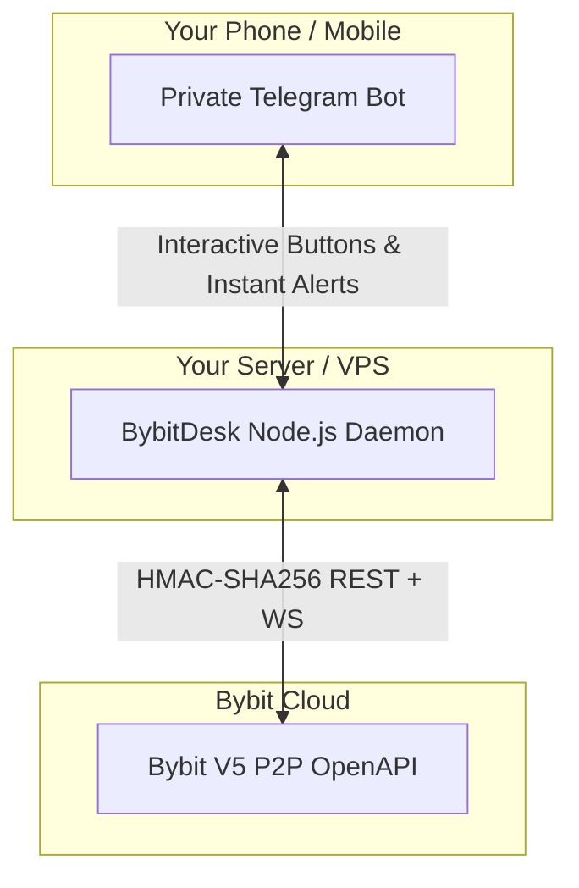

# Implementation Plan: Standalone Bybit P2P Mobile Command Desk

## Goal Description
Evaluate whether the Bybit P2P Open API integration should be built inside the existing `xCap` repository, in a new folder, or as a completely separate project. Provide an architectural verdict and define the execution plan for building a desk-free mobile control desk for Bybit P2P using Bybit's Open API v5 and a private Telegram Bot.

---

## Architectural Verdict: Standalone Dedicated Project

> [!IMPORTANT]
> **Definitive Recommendation: Build a New, Standalone Project (e.g. `BybitDesk`)**
> 
> You have already built, debugged, and cleanly committed **OmniShot** in `xCap`. It is a specialized, high-speed Binance deal sniper that relies on browser automation (Playwright/Chromium).
> 
> Making Bybit a separate project rather than a script or subfolder inside `xCap` is the cleanest, most scalable, and safest approach.

### Comparative Evaluation

| Dimension | Inside `xCap` as a Script / Folder | New Dedicated Standalone Project (`BybitDesk`) |
| :--- | :--- | :--- |
| **Codebase Integrity** | Pollutes a clean, committed Binance repository with unrelated Bybit and Telegram code. | Leaves `xCap` 100% untouched, clean, and dedicated strictly to Binance deal sniping. |
| **Footprint & Bloat** | Inherits `playwright-core` and heavy Chromium browser binaries (~200MB). | Needs **zero browser**. Requires only lightweight REST/WebSocket + Telegram (< 15MB total). |
| **Hosting & Hardware** | Needs 2GB+ RAM to run Chromium. | Can run 24/7 on a $2/month micro VPS or Raspberry Pi with only 256MB RAM. |
| **Process Lifecycle** | Any crash or restart in Bybit could interrupt OmniShot's active sniping. | Total isolation. You can run Bybit 24/7 on your phone while OmniShot runs only when needed at your PC. |
| **Security & Secrets** | Mixing Bybit API keys with Binance session data increases the risk of accidental git leaks. | Clean, isolated `.env` and `.gitignore` dedicated solely to Bybit API credentials and Telegram tokens. |

---

## User Review Required

> [!CAUTION]
> **Security Boundaries:**
> 1. Bybit API keys will require P2P permissions (`Read`, `Trade`, and `Escrow Release`). These must remain strictly inside a `.env` file on your machine/VPS and never committed to version control.
> 2. The Telegram bot **must** enforce a strict whitelist check (`msg.from.id === YOUR_TELEGRAM_ID`) on every single incoming message to ensure no unauthorized third party can send commands to your Bybit account.

---

## The Winning Interface: A Private Telegram Bot

> [!TIP]
> **"The easiest and most efficient option should win."**
> 
> A browser dashboard keeps you tied to your desk or laptop. A **private Telegram bot** running on Node.js connects directly to Bybit's V5 API and gives you **instant, mobile push notifications and 1-tap buttons right in your pocket**.



### Mobile User Experience Preview (In Telegram)

#### 1. Real-time Status & Dashboard (`/status`)
```
⚡ BYBIT P2P REMOTE DESK
━━━━━━━━━━━━━━━━━━━━
📊 Active Sell Ad: #1049281
💵 Price: 252.80 DZD/USDT (🟢 #1 on Orderbook)
💰 Bybit Balance: 1,850.00 USDT
📈 24h Volume: 4,200 USDT (+21,800 DZD profit)
━━━━━━━━━━━━━━━━━━━━
[ 🔄 Reprice to #1 ]    [ ⏸ Pause Ad ]
[ 📋 Active Orders (1) ] [ 📊 Market Depth ]
[ ⚙️ Settings ]          [ 🛑 Emergency Stop ]
```

#### 2. Instant Order Alert with 1-Tap Action
```
🚨 NEW INCOMING ORDER!
━━━━━━━━━━━━━━━━━━━━
🆔 Order: #20261023901
👤 Buyer: Amine_DZ (99.1% completion / 34 orders)
💰 Amount: 25,280 DZD (100 USDT)
⏱️ Escrow Countdown: 14:55
━━━━━━━━━━━━━━━━━━━━
[ 💬 Send Greeting ]     [ 📋 Copy BaridiMob Info ]
```

#### 3. Buyer Paid Alert & 1-Click Escrow Release
```
🔔 BUYER MARKED AS PAID!
━━━━━━━━━━━━━━━━━━━━
Amine_DZ claims payment of 25,280 DZD has been sent.
👉 Verify in your BaridiMob App now.
━━━━━━━━━━━━━━━━━━━━
[ ✅ VERIFIED — RELEASE CRYPTO ]
[ ⚠️ ISSUE — OPEN APPEAL ]
```
*Tapping `[ ✅ VERIFIED — RELEASE CRYPTO ]` directly calls Bybit's `/v5/p2p/order/finish` API. You never have to unlock your PC or open the Bybit app.*

---

## Proposed Changes (New Project: `BybitDesk`)

The existing `xCap` repository remains completely untouched. All work will be created in a new dedicated workspace: `c:\Users\hp\Desktop\Apps\Antigravity\BybitDesk`.

### Configuration & Tooling
#### [NEW] `package.json`
- Initialize minimal dependencies:
  - `axios` (HTTP requests to Bybit V5)
  - `crypto` (Built-in Node.js module for HMAC-SHA256 signatures)
  - `dotenv` (Environment variable management)
  - `node-telegram-bot-api` or `telegraf` (Telegram bot framework)

#### [NEW] `.env.example` & `.gitignore`
- Template for `BYBIT_API_KEY`, `BYBIT_API_SECRET`, `TELEGRAM_BOT_TOKEN`, `TELEGRAM_ADMIN_CHAT_ID`.
- `.gitignore` configured to ignore `.env`, `node_modules/`, and logs.

---

### Core Services
#### [NEW] `src/bybitClient.js`
- Full Bybit V5 OpenAPI wrapper:
  - Robust HMAC-SHA256 request signing (`X-BAPI-API-KEY`, `X-BAPI-TIMESTAMP`, `X-BAPI-SIGN`, `X-BAPI-RECV-WINDOW`).
  - `fetchMarketDepth(currency, token, side)`: Inspect top competitor prices in DZD.
  - `getPendingOrders()`: Query active orders and escrow timers.
  - `updateAdPrice(adId, newPrice)`: Auto-reprice or undercut competitors.
  - `toggleAd(adId, state)`: Pause/resume ads instantly.
  - `releaseEscrow(orderId)`: Finalize orders upon verified payment.
  - `sendOrderMessage(orderId, text)`: Post automated greetings or payment instructions into Bybit chat.

#### [NEW] `src/telegramBot.js`
- Interactive bot service:
  - Whitelist guard on `msg.from.id` to reject unauthorized users.
  - Inline keyboards for `/status`, `/reprice`, `/orders`, `/pause`, and `/kill`.
  - Push notification broadcaster for order creation and payment confirmation events.

#### [NEW] `src/index.js`
- Master process daemon:
  - Initializes the Bybit client and Telegram bot.
  - Starts the background order-polling loop (or WebSocket listener).
  - Graceful shutdown handling (`SIGINT` / `SIGTERM`).

---

## Verification Plan

### Automated Tests
1. **Signature Test**: Verify Bybit HMAC-SHA256 generator against Bybit's documented test vectors to ensure zero signature mismatch errors (`10002: Invalid sign`).
2. **Security Whitelist Test**: Test Telegram message handler with an unauthorized chat ID to verify that all commands are strictly dropped.

### Manual Verification
1. **Telegram Connection Check**: Send `/ping` in the private chat; confirm bot replies with latency check.
2. **Read-Only API Check**: Send `/status` in Telegram; verify the bot successfully queries Bybit V5 and displays your real USDT balance and active ad info.
3. **Price Floor Test**: Configure a safety floor of `251.00 DZD`; trigger an update below the floor; verify the bot refuses to undercut below the floor and alerts you.
4. **End-to-End Test Order**: Place a small test order or inspect an incoming order alert to verify the push alert and inline button functionality.

---

## Open Questions

1. **Project Directory Name**: Would you prefer the new project folder to be called `BybitDesk`, `BybitOps`, or another name in `c:\Users\hp\Desktop\Apps\Antigravity\`?
2. **Telegram Bot Token**: Do you already have a bot created with `@BotFather`, or would you like me to walk you through the 60-second setup?
